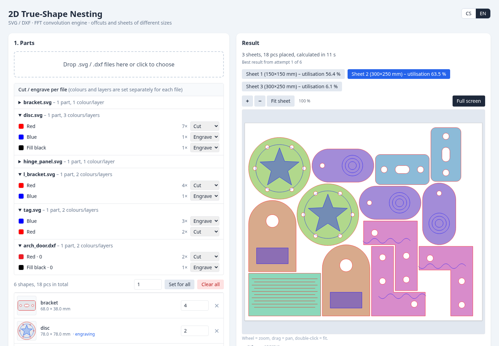
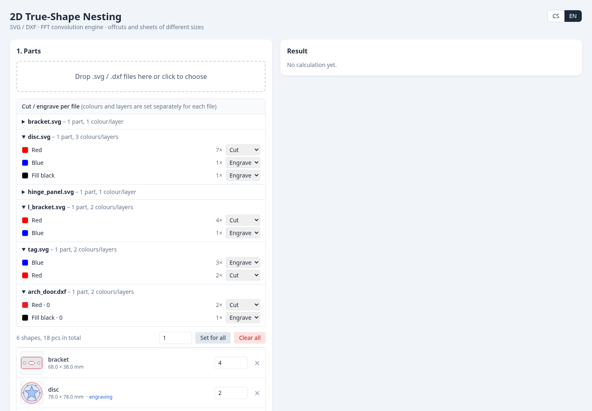
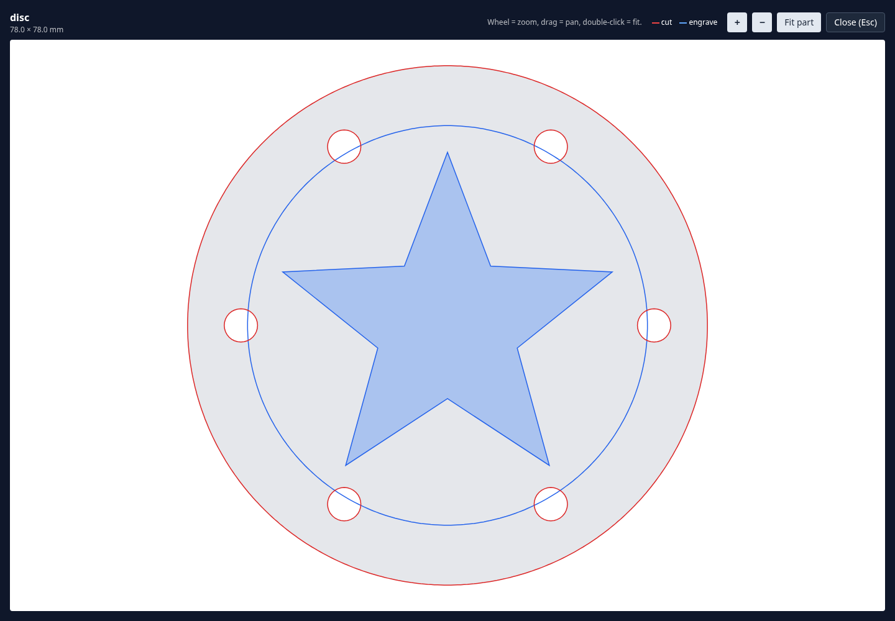

# True-Shape Nesting

A self-hosted web app that packs irregular 2D parts from **SVG and DXF** files onto sheets of material, built for laser cutters and CNC machines. Parts are packed by their **real outline**, not their bounding box, so small parts drop into the holes and gaps of bigger ones. It keeps **cut** and **engrave** geometry apart, understands **offcuts and sheets of different sizes**, and exports clean vector files.



## Features

- **Bulk upload** of `.svg` and `.dxf` files by drag and drop. A file with several shapes is split into separate parts.
- **True-shape nesting** with a hybrid vector/raster FFT engine (details [below](#how-it-works)). Holes are kept free, so parts nest inside other parts.
- **Cut and engrave are separate.** Every colour or layer of every file is mapped to *Cut*, *Engrave* or *Ignore*, with sensible defaults. Open cut lines (fold slits, living hinges) and engraved lines and fills stay attached to their part and move with it.
- **Sheet inventory** with offcuts: any number of sheet sizes, a quantity or *Auto/∞* for each, and two fill strategies (smallest area first, or your own order).
- **Parameters:** part spacing (kerf), sheet margin, rotations (none, 90°, 45°, 15°), grid resolution and an optimisation level.
- **Result viewer** with zoom/pan and a full-screen mode, and a **part viewer** to inspect every imported part up close.
- **Clean vector export** per sheet as SVG or DXF, or all sheets in one ZIP. Cut and engrave are on their own layers, and the sheet outline is included.
- The **last sheet is packed column by column from the left**, so the free area on the right stays in one piece and can be reused as an offcut.
- Czech and English user interface.

| Input: parts and colour mapping | Part viewer |
| --- | --- |
|  |  |

## Quick start

Requires Docker with Compose.

```bash
git clone https://github.com/mhejtmanek/svg_nest.git
cd svg_nest
docker compose up --build
```

Open <http://localhost:8000>, drop the files from [`examples/`](examples) into the page, set the quantities and press **Run nesting**.

### Run without Docker

Requires Python 3.11+ and the GEOS library (`libgeos-dev` on Debian/Ubuntu; the Shapely wheels usually bundle it).

```bash
python -m venv .venv
. .venv/bin/activate
pip install -r requirements.txt
uvicorn app.main:app --reload
```

## Using it

1. **Upload parts.** Each file shows up with the colours and layers found in it. Check the *Cut / Engrave / Ignore* choice per colour and fix it where the default is wrong. The part list shows a thumbnail (cut in red, engraving in blue), the size and the quantity.
2. **Define the sheets.** Enter width and height for each sheet or offcut and either a quantity or *Auto ∞* (unlimited, used for the main material). Choose how sheets are filled:
   - *Offcuts first*: the smallest sheets are filled first, unlimited sheets last.
   - *Custom order*: sheets are taken in the order of the table.
3. **Set the parameters.**
   - *Part spacing / kerf*: minimum distance between any two parts.
   - *Sheet margin*: distance kept free along the sheet edge.
   - *Rotation*: none, every 90°, 45° or 15°.
   - *Grid resolution*: size of one raster pixel. Finer is more precise and slower.
   - *Optimisation*: 1 fast pass, up to 6 or up to 12 attempts with different part orders and packing directions. The best result is kept: all parts placed, then the fewest sheets, then the weakest sheet before the last one as full as possible.
4. **Run nesting** and flip through the sheets. A part that fits on no sheet is listed as *Didn't fit*.
5. **Download** one sheet as SVG or DXF, or everything as a ZIP (`sheet_01_200x300mm.svg`, …).

## How cut and engrave are recognised

Defaults, per colour or layer. Everything can be overridden in the UI for each file separately.

| Source | Becomes |
| --- | --- |
| Red (stroke or DXF colour) | **Cut** |
| Layer name containing `cut`, `rez` or `řez` | **Cut** |
| Dark SVG stroke, or a shape without stroke or fill | **Cut** |
| Any other colour | **Engrave** |
| Layer name containing `grav`, `engrav`, `score`, `etch`, `ryt` or `mark` | **Engrave** |
| DXF `HATCH` | **Engrave** (as a filled area) |
| White (all channels ≥ 240) | **Ignored**, never shown |

Additional rules:

- If a file contains **no cut at all**, everything in it is treated as cut.
- A **filled SVG shape without a stroke** is an engraved area when the file also contains stroked cut lines. In a file made only of fills the shapes are the silhouettes to cut.
- **Closed cut contours** form the outline of a part; contours nested inside it are holes (even-odd rule). **Open cut lines** are never lost: they stay with the part that contains them.
- Open lines whose ends are within 0.1 mm of each other are joined into closed outlines.
- DXF units are read from `$INSUNITS`. SVG is converted to millimetres through the viewBox and 96 px per inch.

## Output

- **Units:** millimetres. **Origin:** the bottom-left corner of the sheet, y pointing up.
- **SVG** has the layers `SHEET`, `ENGRAVE` and `CUT` (Inkscape layers). Coordinates are y-up and the layers carry a flipping `transform` so the picture is not mirrored.
- **DXF** (R2010, units mm) has the layers `SHEET` (grey), `ENGRAVE` (blue) and `CUT` (red). Contours are closed `LWPOLYLINE`s. Engraved areas are written both as `HATCH` entities and as plain boundary polylines, because many laser programs ignore `HATCH`.
- Output geometry is the imported geometry moved and rotated by the computed transform. Curves are flattened to polylines (about 0.02–0.03 mm deviation); nothing is rasterised.

## How it works

1. **Vector preparation.** SVG (`svgelements`) and DXF (`ezdxf`, including blocks, splines, arcs, hatches) are flattened to polylines. Contours are classified into parts, holes and islands with Shapely. Each part is inflated by half the spacing for the collision mask.
2. **Rasterisation.** For every sheet a binary grid of the usable area is created (margin and placed parts are `1`, free space is `0`). For every part and every allowed rotation a conservative mask of the inflated outline is rasterised, so holes stay free.
3. **FFT placement.** Parts are sorted by size, biggest first. For each part and rotation, `scipy.signal.fftconvolve(..., mode='valid')` between the sheet grid and the flipped mask gives the number of overlapping pixels for every possible position. Positions with no overlap are candidates; the one closest to the bottom-left corner wins (optionally weighted towards touching placed parts). Every candidate is verified exactly on the grid before it is accepted.
4. **Multi-size bin packing.** Parts that do not fit stay in the queue and smaller parts keep filling the gaps. When nothing else fits, the next sheet from the inventory is opened. A sheet where no remaining part fits is dropped.
5. **Optimisation.** Several part orderings and packing directions are tried, the best result is kept, and the last sheet is repacked column by column from the left.

## Limits and notes

- State lives **in memory**. Each browser gets an anonymous session cookie (`nest_sid`); uploads and results of different visitors are isolated. A session is dropped after 6 hours of inactivity and everything is lost on restart.
- At most **2 nesting jobs run at the same time**; others wait in a queue. Nesting is CPU heavy: fine grids, 15° rotations and the higher optimisation levels can take a minute or more on large jobs.
- There is **no authentication** and no upload size limit in the app. If you expose it to the internet, put it behind a reverse proxy that adds login, a request size limit and rate limiting.
- The raster grid makes the spacing a guarantee rather than an exact value: parts are at least the requested distance apart, usually a little more (up to about one grid pixel).
- Text is not supported in SVG; convert text to paths first.
- There are no automated tests yet.

## API

The UI uses a small JSON API. All endpoints need the session cookie.

| Method and path | Purpose |
| --- | --- |
| `POST /api/upload` | Upload files (multipart `files`). Returns files with detected colours/layers and parts. |
| `POST /api/files/{id}/roles` | Set `cut` / `engrave` / `ignore` per colour for one file; rebuilds its parts. |
| `DELETE /api/parts/{id}`, `DELETE /api/parts` | Remove one part, or everything. |
| `POST /api/nest` | Start a nesting job. Returns `job_id`. |
| `GET /api/jobs/{id}` | Progress and, when finished, the result. |
| `POST /api/jobs/{id}/cancel` | Cancel a job. |
| `GET /api/jobs/{id}/sheets/{n}.svg` / `.dxf` | Download one sheet (`?preview=true` for the coloured preview SVG). |
| `GET /api/jobs/{id}/download.zip?format=svg\|dxf\|both` | All sheets in one archive. |

Example request body for `POST /api/nest`:

```json
{
  "parts": [{ "id": "a1b2c3d4", "quantity": 4 }],
  "sheets": [
    { "width": 150, "height": 150, "quantity": 1, "auto": false },
    { "width": 300, "height": 250, "auto": true }
  ],
  "spacing": 1.5,
  "margin": 5,
  "rotation_step": 15,
  "resolution": 0.5,
  "strategy": "smallest",
  "optimize": 2
}
```

## Project layout

```
app/
  parser.py     SVG/DXF import, part assembly, SVG/DXF export
  nester.py     rasterisation, FFT placement, multi-size packing, optimisation
  main.py       FastAPI app: sessions, upload, jobs, downloads
  static/       single-page UI (Tailwind and Alpine.js from a CDN, no build step)
examples/       small SVG/DXF files to try it with
docs/           screenshots used in this README
Dockerfile, docker-compose.yml, requirements.txt
```

## Deploying

The container listens on port 8000. A minimal nginx location for a deployment behind HTTPS:

```nginx
client_max_body_size 100m;
location / {
    proxy_pass http://127.0.0.1:8000;
    proxy_set_header Host $host;
    proxy_set_header X-Forwarded-Proto $scheme;
    proxy_read_timeout 300s;
}
```

`X-Forwarded-Proto` makes the session cookie `Secure` when the site is served over HTTPS.
